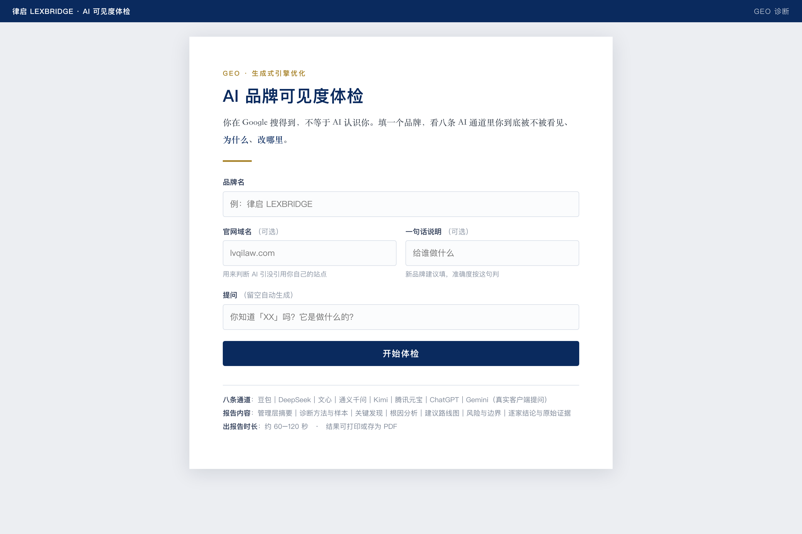
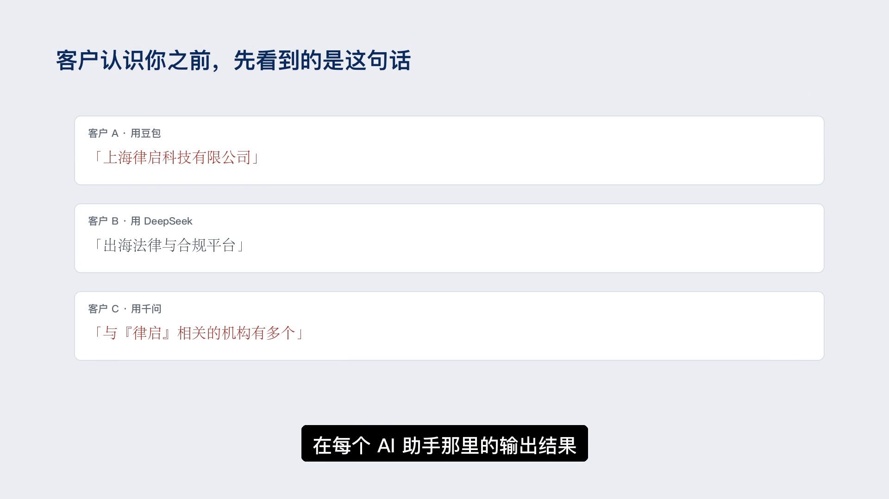
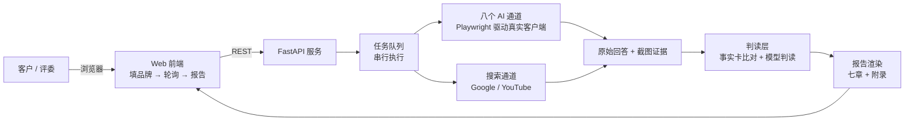
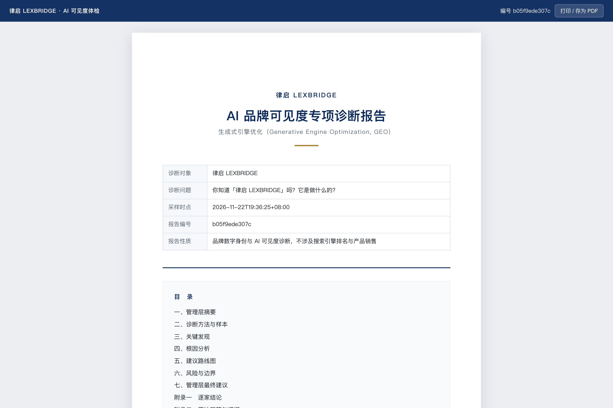
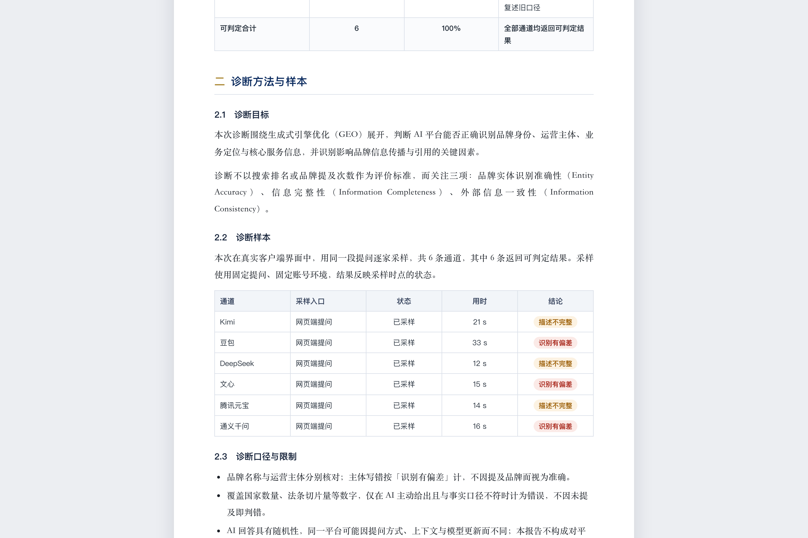

# AI 可见度体检 · AI Visibility Check（GEO）

> DOAI 2026 创客大赛 · 自由创意赛道（AI App）参赛作品
>
> 一句话：**告诉企业——在 AI 眼里你的品牌是什么样，以及怎么把它变成你想要的样子。卖的是判断和动作，不是分数。**



---

## 1. 要解决的问题

客户了解一家公司的方式变了：

- 以前：去搜索引擎搜，自己拼信息，再判断。
- 现在：直接问 AI 助手，"你知道 XX 吗？它是做什么的？"，**AI 给的是结论，不是链接。**

问题是——同一个品牌，问不同的 AI，答案不一样。我们把「律启 LEXBRIDGE」拿去问八家主流 AI，同一个标准问题，出现了四种结果：

| 结果 | 例子（2026-11 实测原句） |
|---|---|
| 说错主体 | 把运营主体写成另一家同名科技公司 |
| 说成别人的业务 | 描述成"欧洲精品律所""创投服务机构" |
| 说的对但不全 | 说出了行业，但没有覆盖范围、产品与服务体系 |
| 说得准 | 描述与官网口径一致 |

**当客户用不同的 AI 认识你，你的品牌第一印象就是不一样的。** 而大多数客户，手边只有一两个 AI，他不会知道答案其实是错的。



---

## 2. 它做什么

输入品牌名，跑完八条 AI 通道，出一份**七章诊断报告**：

1. 管理层摘要（结论 + 证据 + 三个动作）
2. 诊断方法与样本
3. 关键发现（按影响排序，每条都写"改什么"）
4. 根因分析（实体锚点 / 表达结构 / 信源一致性 / 权威背书）
5. 建议路线图（本周 / 一月 / 三月分档）
6. 风险与边界（结论适用范围）
7. 管理层最终建议
+ 附录：逐家结论、原始回答与证据

**几个刻意的取舍：**

| 不做 | 为什么 |
|---|---|
| 不打 0–100 分、不排名 | 分数会让客户盯着数字，而不是盯着"改哪里"。AI 输出每天都在变，分数没有可比性 |
| 不用官方 API 取证 | 客户看到的是客户端 UI 里那句话；API 返回的是另一套结果。只有走真实客户端，才能证明"到底有没有被收录" |
| 不承诺"让 AI 推荐你" | 成交的是判断与路径，不是排名承诺 |
| 不做 SEO 诊断 | SEO 解决"搜得到"，这里解决"AI 认得出、说得准" |

---

## 3. 架构



**技术栈**

- 前端：原生 HTML/CSS/JS（无框架，首屏轻、部署简单）
- 服务：Python 3 / FastAPI + Uvicorn
- 采集：Playwright 连接真实浏览器会话，逐家提问、逐段截帧存证
- 判读：事实卡（品牌主体、口径、数字）+ 大模型判读（关思考模式，输出结构化结论）
- 存储：每次运行落 JSON（原始回答、截图索引、时间戳），可回溯

**一条通道长什么样**

```
打开客户端 → 输入标准问题「你知道「X」吗？它是做什么的？」
→ 等待回答稳定 → 抓正文 + 截图 → 提取"提没提到 / 说的是谁 / 说的对不对"
```

标准问题固定不变，不随产品走——这样八家的答案才可比、复测才可比。

---

## 4. 证据与数据来源

报告里的每一句结论都要能对回原文：

| 字段 | 内容 |
|---|---|
| 采样时点 | 精确到秒，报告封面可见 |
| 平台 | 哪一家 AI（豆包 / DeepSeek / 文心 / 通义千问 / Kimi / 腾讯元宝 / ChatGPT / Gemini） |
| 原句 | AI 的原始回答片段，不改写 |
| 截图 | 客户端界面截图，作为"它真的这么说过"的凭据 |
| 判定 | 准确 / 描述不足 / 无第三方背书 / 口径偏差 / 索引缺失 |

**隐私**：报告只分析公开可检索的品牌信息，不采集个人数据；客户提交的品牌名只用于当次体检。




---

## 5. 一次体检的时间线

```
提交品牌（0s）
  └─ 八条通道并行提问（约 40–60s）
       └─ 回答稳定 + 截图存证
  └─ 事实卡比对 + 模型判读（约 25–30s）
       └─ 结构化结论
  └─ 渲染报告（约 1s）
总计约 90 秒；单次运行串行排队，保证通道稳定。
```

---

## 6. 边界（写在报告里，也写在这里）

- AI 输出有动态性：同一问题不同时间可能不同，报告结论只代表采样时点。
- 复测必须保持"平台 + 提问"不变，才有前后对照意义。
- 不构成对任何平台长期表现的预测；不涉及搜索引擎排名与产品销售。

---

## 7. 演示

- **演示视频（2 分 32 秒）**：https://www.bilibili.com/video/BV1iAyLzaE2L/
- **在线 Demo**：定向邀请制（演示机为实时运行，需要开邀请链接才能执行，避免被滥用）

---

## 8. 关于这个仓库

这是一个**展示仓库**：放产品说明、架构、界面与报告样例。
核心采集与判读实现未开源（涉及真实客户端会话与判读策略），如需技术交流请联系作者。

主办方 / 评委如需查看某一环节的实现方式，可通过参赛平台联系。

---

## 9. 团队

个人参赛 · 律启 LEXBRIDGE（南京市观眇信息咨询有限责任公司）

- 产品与法律内容：李阳（执业律师，江苏圣典律师事务所高级合伙人）
- 工程与数据：律启团队

---

_文档随产品迭代更新，最近更新：2026-11-22_
